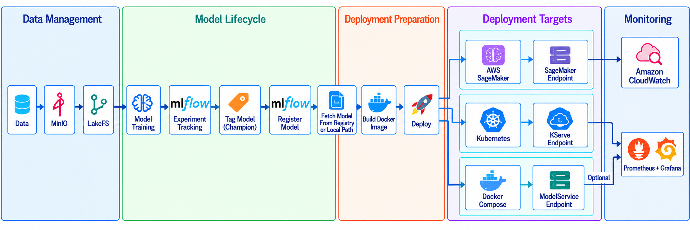

# MLOps Blueprint for Model Training, Deployment, and Monitoring

  

  <em>Figure: MLOps reference architecture and implementation overview.</em>

The repository contains two independent components:

## `model_training/`

Supporting workflow for model training and registration.

See [`model_training/README.md`](model_training/README.md) for setup and execution instructions.

## `model_deployment/`

Deployment and monitoring blueprint. It supports deployment from an MLflow-registered model or a standalone local model through AWS SageMaker, Kubernetes/KServe, or Docker Compose.

See [`model_deployment/README.md`](model_deployment/README.md) for prerequisites, configuration, deployment, monitoring, and teardown instructions
