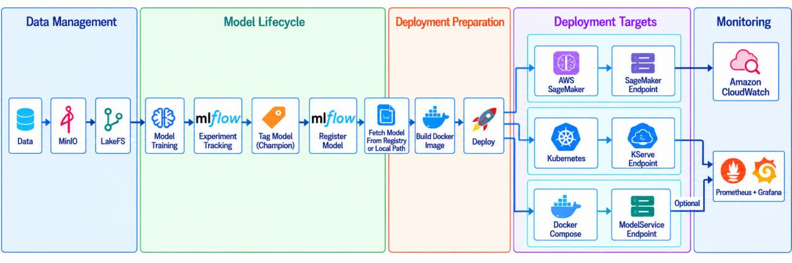

# Deployment Architecture

## 1. Purpose and Scope

This document describes the deployment and monitoring part of the MLOps blueprint: the reference architecture and the reference implementation in `model_deployment/`.

The architecture covers the **downstream** part of the ML lifecycle. It starts once a model is **registered**. Its responsibilities are to resolve the model and its version, prepare a reproducible deployment artifact, select and run a deployment target, expose inference, and connect operational monitoring. Data management, training, experiment tracking and model registration happen **before** this point and are not part of it.

It targets three environment categories from the literature, which hybrid systems can combine:
- **Cloud:** elastic, managed resources.
- **On-Premises:** direct organisational control and self-managed operation.
- **Edge/IoT:** limited resources, mixed hardware, restricted connectivity.

The reference implementation realises the architecture with **three concrete backends**:
- **AWS SageMaker**: a managed deployment service.
- **Kubernetes/KServe**: cluster-based orchestration and serving.
- **Docker Compose**: deployment on a single container host.

All three share one workflow. They are implementation targets, **not** one-to-one equivalents of Cloud, On-Premises and Edge/IoT. Docker Compose is the lightweight self-managed path (no managed endpoint, cluster or remote registry) for development machines, servers and compatible single-board computers; it does not stand for the whole Edge/IoT category.

## 2. Requirements

### 2.1 Functional Requirements

| ID | Name | Scope | Meaning |
|---|---|---|---|
| FR-01 | Registered Model and Version Resolution | Core | The registered model is the handover point; the model and its version must be resolved. |
| FR-02 | Reproducible Model Packaging | Core | The model and its execution dependencies are prepared reproducibly. |
| FR-03 | Target-Environment Model Deployment | Core | The packaged model is deployed to the selected target. This is kept separate from serving. |
| FR-04 | Model Serving and Inference Exposure | Core | The deployed model is exposed as an inference service. |
| FR-05 | Automated Deployment Pipeline Execution | Core | Deployment is automated so that it can be repeated. |
| FR-06 | Controlled Model Update and Rollback | Supporting | Models can be replaced, updated and recovered where the target platform supports this. |
| FR-07 | Operational Monitoring and Metric Collection | Core | The running service is monitored operationally. |
| FR-08 | Model/Data Monitoring and Drift Detection | Extensible | Drift and data-quality monitoring. Extensible because it depends on production data and reference data specific to the application. |
| FR-09 | Feedback and Upstream Lifecycle Triggering | Upstream interface | Deployment or monitoring evidence can later inform upstream lifecycle activities. Retraining itself is not part of this architecture. |

### 2.2 Non-Functional Requirements

The "Main relevance" column shows where a requirement is especially prominent. It does not limit the requirement to that environment.

| ID | Name | Main relevance |
|---|---|---|
| NFR-01 | Portability | Cross-environment |
| NFR-02 | Interoperability | Cross-environment |
| NFR-03 | Scalability and Elasticity | Especially Cloud |
| NFR-04 | Reliability, Availability, and Recoverability | Cross-environment |
| NFR-05 | Resource Efficiency and Connectivity Tolerance | Especially Edge/IoT |
| NFR-06 | Heterogeneous Hardware Compatibility | Especially Edge/IoT |
| NFR-07 | Security, Privacy, Data Sovereignty, and Governance | Cross-environment; strong On-Premises relevance |
| NFR-08 | Operational Control | Especially On-Premises |
| NFR-09 | Maintainability, Modularity, and Extensibility | Cross-environment |
| NFR-10 | Reproducibility and Traceability | Cross-environment |

### 2.3 Architectural Requirements

| ID | Name | Derived from |
|---|---|---|
| AR-01 | Registered-Model Integration and Version Resolution | FR-01; NFR-02, NFR-10 |
| AR-02 | Reproducible Deployment Artifact Preparation | FR-02; NFR-01, NFR-05, NFR-06, NFR-10 |
| AR-03 | Common Deployment Control, Target Selection, and Target-Specific Realization | FR-03, FR-05; NFR-01, NFR-02, NFR-05, NFR-06, NFR-08, NFR-09 |
| AR-04 | Environment-Appropriate Inference Serving | FR-04; NFR-02, NFR-03, NFR-04, NFR-05, NFR-06 |
| AR-05 | Automated and Traceable Deployment Workflow | FR-01–FR-05; NFR-04, NFR-09, NFR-10 |
| AR-06 | Controlled Deployment Update and Recovery | FR-06; NFR-04, NFR-10 |
| AR-07 | Common Operational Monitoring with Target-Specific Observability | FR-07; NFR-02, NFR-05, NFR-07, NFR-08, NFR-09 |
| AR-08 | Extensible Model/Data Monitoring and Lifecycle Feedback | FR-08, FR-09; NFR-02, NFR-05, NFR-07, NFR-09 |
| AR-09 | Modular and Extensible Cross-Deployment Structure | NFR-01, NFR-02, NFR-09 |
| AR-10 | Environment-Constraint-Aware Realization | FR-03, FR-04, FR-07; NFR-03–NFR-08 |

Not every requirement is fully implemented; some are extension points or lifecycle interfaces (Section 6).

## 3. Reference Architecture

### 3.1 Layers and Responsibilities

The architecture separates **common responsibilities** from **target-specific realisations**. It has five lanes:

1. **Data management and model lifecycle (upstream, out of scope):** training, tracking, champion tagging, registration in the MLflow Model Registry.
2. **Deployment preparation (common):** configuration and validation, model resolution (registry or local artifact), deployment plan with dry-run boundary, Docker image with the shared serving application, backend dispatch, structured results, teardown.
3. **Deployment targets (target-specific):** adapters owning resource model, readiness, endpoint semantics and monitoring integration (SageMaker Model/Endpoint Configuration/Endpoint; KServe InferenceService; Compose project with `model-service`).
4. **Serving (common):** FastAPI application with format-specific adapters, offering health, prediction and metrics interfaces.
5. **Monitoring:** operational observability (Prometheus/Grafana self-managed, CloudWatch on AWS), model/data monitoring as extension boundary, and a feedback interface upstream.

### 3.2 Component Interactions

*Kachhadiya 2026, Figure 5.1: reference architecture and implementation overview.*
Five lanes from left to right: **Data Management** (data, object store, LakeFS); **Model
Lifecycle** (model training, experiment tracking, tagging the champion, registering the model in
MLflow); **Deployment Preparation** (fetching the model from the registry or a local path,
building the Docker image, deploying); **Deployment Targets** (AWS SageMaker with a SageMaker
endpoint, Kubernetes with a KServe endpoint, Docker Compose with a ModelService endpoint); and
**Monitoring** (Amazon CloudWatch for SageMaker, Prometheus and Grafana for Kubernetes and,
optionally, Docker Compose).

Implementation note: the figure shows MinIO as the object store; the training part now bundles
SeaweedFS (any S3-compatible endpoint works).

The arrow marked "Optional" is the operational monitoring of the Docker Compose target, which is optional there.

### 3.3 Mapping of Architectural Requirements to Components

| AR | Realising component(s) |
|---|---|
| AR-01 | Model resolution: registry mode (alias or explicit version) and standalone mode (content fingerprint as version) |
| AR-02 | Artifact preparation: Docker image with explicit target platform, image identity linked to model version |
| AR-03 | Common deployment control, plus backend adapters that share one contract (preflight, deploy/reconcile, wait for readiness, attach monitoring, return a result) |
| AR-04 | Shared FastAPI serving layer hosted by SageMaker, KServe or Compose |
| AR-05 | Common workflow: validation, plan, build, dispatch, structured result, stage-specific errors and logging |
| AR-06 | Stable deployment identity with versioned artifacts, reconciliation on redeploy, backend-aware teardown |
| AR-07 | Service instrumentation plus Prometheus/Grafana (self-managed paths) or CloudWatch (AWS) |
| AR-08 | Model/data monitoring and feedback interface: extension boundary with no mandatory product |
| AR-09 | Package split into common modules and `deployments/<backend>/` adapters, with reusable `serving/` and `monitoring/` |
| AR-10 | Target-specific settings: platform, capacity, replica/resource/scheduling controls, optional bundled monitoring |

## 4. Realisation in the Reference Implementation

All paths below are relative to `model_deployment/`.

### 4.1 Components

| Responsibility | Files |
|---|---|
| Common control and dispatch | `main.py` (entry point `deploy.py`) |
| Configuration and validation | `config.py`, `.env.example` |
| Shared types, errors, naming | `core.py` (`DeploymentPlan`, `DeploymentResult`, `DeploymentError`, stable/versioned naming) |
| Registry resolution | `champion.py` |
| Standalone model resolution | `local_model.py` (format detection, SHA-256 fingerprint as version) |
| Artifact preparation | `container/containerize.py`, `container/Dockerfile` |
| Backend adapters | `deployments/sagemaker/`, `deployments/kubernetes/` (with `inferenceservice.yaml.j2`, `podmonitor.yaml.j2`), `deployments/docker_compose/` (with `compose.yaml.j2`, `prometheus.yml.j2`) |
| Serving | `serving/app.py`, `serving/inference.py`, `serving/metrics.py`, `serving/entrypoint.py` |
| Monitoring integrations | `monitoring/prometheus.py`, `monitoring/cloudwatch.py`, `monitoring/grafana/operational-dashboard.json` |
| Cleanup | `teardown.py` (dry run by default; removes resources only with explicit execution) |

All three backends in the reference architecture are implemented. The backend is chosen by configuration (`DEPLOYMENT_BACKEND` or `--backend`). The common source code does not change.

> **Implementation note:** When a registry model is resolved through its alias, `champion.py` also checks that the source run is tagged `champion=true` and has a logged `champion_metric` that is not a test metric. The thesis only requires a "controlled alias".

### 4.2 Packaging

`container/Dockerfile` builds on `python:3.12-slim`, installs FastAPI, Uvicorn, NumPy and pandas, then **only** the runtime for the resolved source/format (MLflow plus the model's `requirements.txt`, TensorFlow, ONNX Runtime, joblib/scikit-learn, PyTorch or XGBoost). Model name, version, source and format are baked into the image as build arguments and environment variables. `prometheus-client` is installed only when `ENABLE_PROMETHEUS_METRICS=true`. `containerize.py` enables this for `kubernetes` and `docker_compose` only.

The image tag is deterministic and derived from the model identity and version. The build passes `--platform` explicitly. For SageMaker (ECR) and Kubernetes the image is pushed to a registry. Docker Compose uses the local image.

### 4.3 Serving Interface

`serving/entrypoint.py` starts Uvicorn on container port `8080`. `serving/app.py` loads the model when it starts and exposes these endpoints:

| Endpoint | Purpose |
|---|---|
| `GET /health` (alias `GET /ping`) | Liveness: returns status, model, version, source, format |
| `POST /predict` | Generic prediction; body is `{"instances": [...]}` or `{"inputs": ...}` (or a raw JSON payload), response is `{"predictions": [...]}` |
| `POST /invocations` | SageMaker-compatible prediction |
| `GET /v1/models`, `GET /v1/models/{name}`, `POST /v1/models/{name}:predict` | KServe V1 protocol |
| `GET /metrics` | Prometheus exposition; returns `404` when instrumentation is disabled (SageMaker image) |

Invalid input returns `400`, inference failures `500`; both count as errors.

> **Implementation note:** The thesis names health, prediction and metrics interfaces. The `/ping`, `/invocations` and KServe V1 routes are how the implementation meets the endpoint conventions of each target.

### 4.4 Docker Compose Realisation

`deployments/docker_compose/helpers.py` renders `compose.yaml.j2` into a project-scoped runtime directory. The Compose project name is stable: `COMPOSE_PROJECT_NAME`, or a name derived from the model.

`model-service` publishes `COMPOSE_MODEL_PORT` (default `8000`) mapped to `8080` and sets `ENABLE_PROMETHEUS_METRICS=true`. It uses `restart: unless-stopped` and a Python-based healthcheck against `/health`. The deployment waits for both the container state and the health status before it reports readiness.

Prometheus (`COMPOSE_ENABLE_PROMETHEUS`, port `9090`) and Grafana (`COMPOSE_ENABLE_GRAFANA`, port `3000`) are both **off by default** and can be switched on independently. If Grafana is enabled without Prometheus, it needs `COMPOSE_EXTERNAL_PROMETHEUS_URL`. Invalid combinations and host-port conflicts are rejected.

> **Implementation note:** The monitoring images are pinned to `prom/prometheus:v3.13.1` and `grafana/grafana:13.2.1`. The generated Compose file sets no Grafana admin credentials, so bundled Grafana keeps the image defaults.

### 4.5 Metrics Collection and Visualisation

`serving/metrics.py` defines four metric families, each labelled with `model` and `version`:
- `model_up` (gauge; 1 once the model has loaded);
- `inference_requests_total` (counter);
- `inference_errors_total` (counter);
- `inference_duration_seconds` (histogram).

Collection depends on the backend:
- **Compose:** `prometheus.yml.j2` scrapes `model-service:8080/metrics` every 15 s.
- **Kubernetes:** a `PodMonitor` connects the predictor to an existing Prometheus Operator. Target discovery can optionally be verified through `KUBE_PROMETHEUS_URL`.
- **AWS:** `monitoring/cloudwatch.py` creates or updates a CloudWatch alarm on `ModelLatency`.

For bundled Grafana, the helper provisions a Prometheus datasource and the dashboard `monitoring/grafana/operational-dashboard.json`. The dashboard has four panels: request rate, error rate, P95 inference latency and model availability.

> **Implementation note:** After a Compose deployment with bundled Prometheus, the workflow waits until Prometheus reports the `model-service` target as healthy (`monitoring/prometheus.py`). The thesis does not describe this check.

### 4.6 Not Realised in This Implementation

- Model/data monitoring (data drift, concept drift, prediction quality). Evidently AI and similar tools are not integrated.
- A feedback path or automated triggering of retraining, re-registration or redeployment.
- Explicit, uniform rollback across backends. Updates happen through reconciliation to a new version.
- Centralised logging (ELK/EFK).
- Provisioning of infrastructure: AWS accounts and IAM, Kubernetes/KServe, registries, shared monitoring stacks.

> **Implementation note:** The thesis describes validation and smoke-test utilities (a `test/` directory, Appendix A.2), and `README.md` Section 9 refers to them. They are not included in this package.

> **Implementation note:** `README.md` lists `ModelMesh` as a value for `KUBE_KSERVE_DEPLOYMENT_MODE`. The thesis names Standard and Knative.

## 5. Design Decisions

| ADR | Context | Decision | Consequences |
|---|---|---|---|
| 1. Registered model as boundary | Deployment must connect to model management without taking on training | Start at an MLflow model (explicit version or controlled alias); accept a local artifact on the same path | MLflow-compatible; no imports from training; local mode supports bounded formats only |
| 2. Common core, target-specific adapters | Platforms differ in APIs, resources, readiness, monitoring | Common resolution/planning/packaging/serving/results; one adapter contract | Targets switch by configuration; platforms not treated as equivalent |
| 3. Docker as artifact | FR-02/AR-02; strong Docker representation in all environments | One image per model version, explicit platform | Runs on x86-64 and ARM64; registry push where required |
| 4. FastAPI serving layer | Several model formats | Common FastAPI app plus format adapters; TF Serving, TorchServe, Triton not the core | Uniform behaviour and instrumentation; serving replaceable |
| 5. Three backends | Demonstrate via different mechanisms | SageMaker (managed), Kubernetes+KServe (cluster; Swarm/Nomad/Mesos less represented), Compose (standalone host) | Not exhaustive for any environment category |
| 6. Target-specific monitoring | Need operational evidence, not one product | Prometheus/Grafana self-managed, CloudWatch on AWS; ELK/EFK not core | Kubernetes relies on existing Prometheus Operator and Grafana |
| 7. Model/data monitoring as boundary | Drift monitoring needs application-specific reference data | Evidently AI an option, not mandatory | FR-08/FR-09 remain architectural |
| 8. Stable identity, versioned artifacts | Updates must not create unrelated identities | Stable endpoint/service/project; versioned images; content fingerprint for local files | Same-version reconciles; new version updates same deployment |
| 9. Validate and plan first | Consequential actions should be inspectable | Validate only selected settings, preflight, plan; dry run stops there | Early errors; unused backends impose nothing |
| 10. Opt-in Compose monitoring | Hosts differ in resources and existing monitoring | Metrics always exposed; Prometheus/Grafana optional | Model-only, bundled, or external monitoring |
| 11. Scoped teardown | Shared infrastructure is not deployment-owned | Remove only identity-derived resources; credentials stay external | Safe cleanup; no infrastructure provisioning |

## 6. Known Limitations and Non-Goals

- **Update and rollback:** Same-version and new-version updates are supported. Explicit rollback semantics are not uniform across backends, so FR-06 is only partly met.
- **Monitoring scope:** Only operational observability is implemented: health, requests, errors and latency. There is no drift detection, prediction-quality monitoring or automated lifecycle feedback (FR-08 and FR-09 are extension points).
- **Not evaluated:** scaling/elasticity (replica settings exist), failover, disaster recovery, long-running availability, intermittent connectivity, and a broad hardware matrix (only ARM64 on DGX Spark and a Raspberry Pi was shown).
- **Security and governance:** Boundaries exist (external credentials, pull secrets), but no penetration, privacy, governance or compliance assessment was done.
- **Constrained hosts:** Images and optional monitoring can need a lot of storage. On a Raspberry Pi 4 (2 GB RAM, SD card), the Grafana pull failed with "no space left on device" until storage was enlarged.
- **Bounded formats:** Custom Keras objects must be available, PyTorch state-dict checkpoints are unsupported, pickle files must be trusted, and ONNX needs a compatible provider. Preprocessing code is not rebuilt.
- **No infrastructure automation:** No cloud accounts, IAM, clusters, registries or shared monitoring are created.
- **Generalisability:** The three backends do not represent every platform in each environment category.

---

*Sources:* Kachhadiya 2026, Sec. 2.3, 2.4, 3.4, 3.6, 4.5 (Tables 4.1–4.3), 4.6, 4.7 (Table 4.7), 5.1–5.6 (Fig. 5.1, Tables 5.1–5.4), 6.4, 7.2, 7.3, 7.5, 9.
