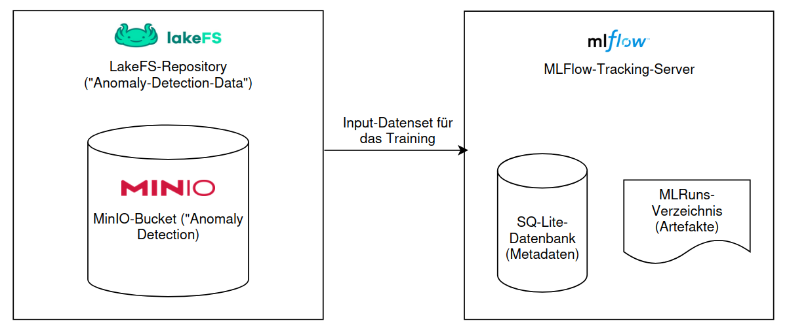
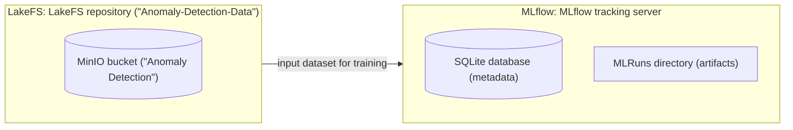
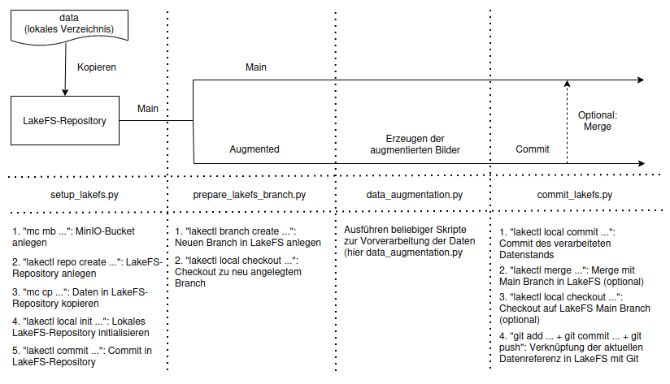
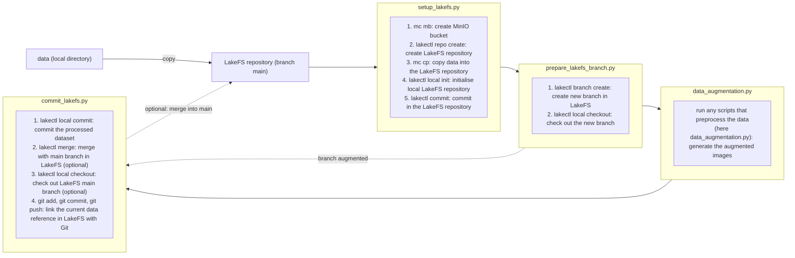
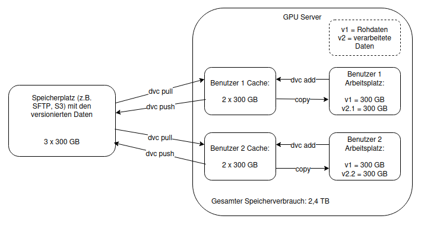
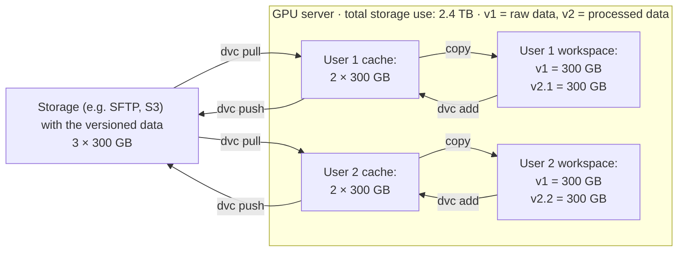

# Training Architecture: Data Versioning, Experiment Tracking and Model Management

## 1. Purpose and scope

The training part of the blueprint gives a project a standardized, traceable and reproducible way to develop ML models. It covers the development phase of the lifecycle and its three foundations: **data versioning** (dataset versions and their lineage can be restored for reproduction, auditing or reuse), **experiment tracking** (each run records which data, architecture and hyperparameters produced which metrics) and **model management** (a central, documented collection through which data scientists hand models over to engineers who integrate and operate them).

The blueprint defines two variants, depending on the size of the data:

| Variant | Typical data | Tooling |
|---|---|---|
| Large-data variant | Image data in the range of several hundred MB to GB (reference case: 339 images, about 854 MB) | LakeFS on an S3-compatible object store for data versioning; MLflow for experiment tracking and model management |
| Small-data variant | Small tabular or time-series files (reference case: one CSV file of about 6.6 MB) | DVC (with DVCLive) for data versioning, pipelines and experiment tracking, all repository-based and serverless |

**This implementation instantiates the large-data variant.** The reference application classifies images of 3D-printed bolts into defect classes or as defect-free; the class is given by the image's directory, and the data is split into `data/train`, `data/val` and `data/test`. The small-data variant is implemented in `model_training_small/` (a DVC pipeline with DVCLive; a persisted scaler and `predict.py` were added on 2026-09-30 so that the variant has an inference path). Deployment and monitoring are out of scope (Section 6).

## 2. Requirements catalog

The requirements are derived from Kumara et al. and Ruf et al., complemented by the author's own definitions.

| ID | Name | Definition | Origin |
|---|---|---|---|
| DV_1 | Compatibility with different data sources | The tool is suitable for different kinds of data sources (e.g. databases, S3 storage, individual files). | Ruf et al. |
| DV_2 | Data lineage | The history and the individual processing steps can be traced from the origin to the finished model. | Kumara et al. |
| DV_3 | Storage and versioning of data | The tool provides a way to store datasets and their versions. | Ruf et al., Kumara et al. |
| DV_4 | Deduplication | Storage space is used efficiently; identical data is not stored more than once. | Own definition |
| DV_5 | Data catalog / data management | There is an overview of the datasets, including information on how they were created. | Ruf et al. |
| EV_1 | Experiment tracking | The tool can store experiments (data, model, hyperparameters) and offers ways to compare experiments. | Ruf et al., Kumara et al. |
| EV_2 | Suitability for different model types | The tool supports different model types (e.g. decision trees, neural networks). | Ruf et al. |
| EV_3 | Hyperparameter optimization | The tool has built-in functions for optimizing hyperparameters. | Ruf et al. |
| EV_4 | Framework compatibility | The tool is compatible with and easy to use with popular ML frameworks (e.g. TensorFlow, Keras, PyTorch) and enables, for example, automatic tracking of experiments. | Ruf et al. |
| EV_5 | Low invasiveness | Tracking experiments and using the tool in general require only small interventions in and changes to existing code; integration into existing training scripts needs only minor adjustments. | Own definition |
| MV_1 | Model registry | Models are stored in a central collection together with their version and metadata. | Ruf et al. |
| MV_2 | Documentation on the model | Notes on how a model was created or how it is to be used can be documented directly with the model. | Own definition |
| GA_1 | Scalability | The tool remains usable as the number of users and projects grows. | Ruf et al. |
| GA_2 | API available | A compatible API for controlling the tool is available; its functions can be accessed programmatically. | Ruf et al. |
| GA_3 | Maturity of the tool | The tool is technically mature and at a stage where it is suitable for production use. | Ruf et al. |
| GA_4 | Usability | The tool has an intuitive user interface and is understandable for non-technical people as well. | Ruf et al. |
| GA_5 | Documentation | The tool is sufficiently documented and describes its usage in detail with intuitive examples. | Own definition |
| GA_6 | User and permission management | The tool has its own configurable user management for organizing collaboration in teams. | Kumara et al. |
| GA_7 | Open source and free of charge | The tool's source code is openly available and the tool can be used free of charge. | Ruf et al. |
| GA_8 | Simple setup | The tool is easy to set up and needs no special infrastructure. | Own definition |

GA_7 was treated as an essential requirement for the tool selection (see ADR-1).

## 3. Architecture

### 3.1 Components and responsibilities

| Component | Responsibility | Implementation |
|---|---|---|
| S3-compatible object store | Physical storage of the dataset objects (LakeFS blockstore); bundled locally or an existing S3 service | `infra/docker-compose.yml` (`seaweedfs`, profile `local-s3`), `s3_bucket.py` |
| LakeFS | Versioning layer over the object store: branches, commits and merges on the data without duplicating it; a commit ID identifies an immutable data version; web UI and user management | `infra/docker-compose.yml` (`lakefs`), `setup_lakefs.py`, `prepare_lakefs_branch.py`, `commit_lakefs.py` |
| Local data checkout | Working copy of a LakeFS branch under `data/`; `data/.lakefs_ref.yaml` records its repository and commit | `lakectl local` |
| Git repository | Versions code and the data reference, so that code commit and data version belong together | `commit_lakefs.py` |
| MLflow tracking server | Records each run: parameters, metrics, dataset input (LakeFS commit), Git commit, artifacts, model; web UI for comparing runs | `infra/docker-compose.yml` (`mlflow`), `train.py` |
| Training code | Loads versioned data, trains, logs to MLflow, marks the champion run | `train.py`, `train_seitlich.py`, `helper_functions.py`, `plot_metrics.py` |
| MLflow Model Registry | Central collection of model versions with metadata and tags; an alias names the version consumers use | `mlflow_registry.py`, `champion_validation.py` |
| Export | Self-describing model package for deployment | `export_champion.py` |

Implementation note: the thesis uses MinIO as the object store; the bundled store here is SeaweedFS (Apache-2.0), because MinIO images were discontinued in 2025/2026. Any S3-compatible endpoint can be configured via `S3_*` variables.

Implementation note: LakeFS is pinned to version 1.86.0, the last release under the Apache-2.0 licence.

Implementation note: the thesis runs MLflow as a local server (SQLite, artifacts in `mlruns`); here it is a container with SQLite backend and served artifacts in its own volume, not in the S3 store.

### 3.2 Component and flow diagram

*Saur 2026, Figure 4.8 (original German caption: "Aufbau und Zusammenspiel von LakeFS und MLflow").*
The LakeFS repository ("Anomaly-Detection-Data") keeps its data in an S3 bucket ("Anomaly Detection")
and provides the versioned input dataset for training; the MLflow tracking server stores run
metadata in an SQLite database and run artifacts in its MLRuns directory. The training code and
the Git repository (not drawn) connect the two: a run logs the LakeFS commit as its dataset input.

Transcription of Figure 4.8 (same elements and labels; German labels translated):

Implementation note: the figure shows MinIO as the object store; the bundled store is now SeaweedFS
(any S3-compatible endpoint works), and MLflow's artifacts live in the tracking server's container
volume.

### 3.3 Requirement-to-component mapping

The ratings are the thesis's evaluation on its three-level scale (`++` fully met, `+` partially met or with restrictions, `-` not met).

| Requirement | Addressed by | Rating | Remark |
|---|---|---|---|
| DV_1 | LakeFS | ++ | Layer over existing object stores |
| DV_2 | LakeFS + MLflow + Git | LakeFS: + | Lineage from the combination: MLflow links data version, code commit, metrics |
| DV_3 | LakeFS on the object store | ++ | |
| DV_4 | LakeFS | ++ | Branches without copying data |
| DV_5 | (none) | LakeFS: - | |
| EV_1 | MLflow tracking | ++ | |
| EV_2 | MLflow tracking | ++ | |
| EV_3 | MLflow tracking | + | |
| EV_4 | MLflow autologging | ++ | Keras autologging in `train.py` |
| EV_5 | MLflow | + | |
| MV_1 | MLflow Model Registry | ++ | |
| MV_2 | MLflow Model Registry | + | Plus the exported model card |
| GA_1 | LakeFS, MLflow | ++ (both) | |
| GA_2 | LakeFS, MLflow | ++ (both) | |
| GA_3 | LakeFS, MLflow | ++ (both) | |
| GA_5 | LakeFS, MLflow | ++ (both) | |
| GA_7 | LakeFS, MLflow | ++ (both) | |
| GA_4 | LakeFS, MLflow | + (both) | Own servers; LakeFS also an object store |
| GA_8 | LakeFS, MLflow | + (both) | Own servers; LakeFS also an object store |
| GA_6 | LakeFS, MLflow | ++ / + | |

## 4. Workflow

*Saur 2026, Figure 4.9 (original German caption: "Ablauf bei der Erzeugung der augmentierten Bilddaten").*
Four scripts move the data through LakeFS: `setup_lakefs.py` creates the bucket and the LakeFS
repository, copies the local `data/` into it, initialises the local checkout and commits;
`prepare_lakefs_branch.py` creates the branch `augmented` and checks it out; `data_augmentation.py`
(or any other preprocessing script) writes the augmented images; `commit_lakefs.py` commits the
processed dataset, optionally merges it into `main` and checks `main` out again, and commits the
current data reference to Git.

Transcription of Figure 4.9 (same elements and labels; German labels translated):

Implementation note: the figure lists `mc` (MinIO client) commands; the implementation creates the
bucket with boto3 and uploads through `lakectl local commit`, so no object-store client is needed.

The workflow leads from raw data to an exported champion model. File references are relative to `model_training/`. All tools are configured through environment variables (`.env`, `infra/.env`), not by editing code.

1. **Infrastructure.** Object store, LakeFS and MLflow run as one Compose stack (`infra/docker-compose.yml`); the bundled object store is optional.
2. **Initial data commit.** `setup_lakefs.py` creates the bucket if missing, creates the LakeFS repository on it, links `data/` to the `main` branch and commits the local files as the first data version; `data/.lakefs_ref.yaml` then records the current commit.
   Implementation note: the bucket is created idempotently via boto3 (`s3_bucket.py`); files are uploaded by `lakectl local commit` itself, so no separate S3 client is needed.
3. **Branch for augmentation.** `prepare_lakefs_branch.py` creates the branch `augmented` from `main` and checks it out into `data/`, isolating the data change like a Git feature branch.
4. **Augmentation.** `data_augmentation.py` adds augmented images (rotation, shift, shear, zoom, horizontal flip; five per original) to `data/train` only; validation and test data stay untouched.
5. **Augmentation commit.** `commit_lakefs.py` commits the extended dataset to the branch, optionally merges it into `main`, and commits the data reference to Git (push is opt-in). The new commit ID is the data version for subsequent runs.
6. **Training run.** `train.py` starts an MLflow run and logs the dataset input with source `lakefs://<repository>/<commit>` from `.lakefs_ref.yaml`. Keras autologging records parameters, training metrics and the model; the script also logs validation and test metrics (including a binary defective/defect-free accuracy) and the confusion matrix. MLflow shows the run's Git commit.
7. **Champion selection.** `train.py` compares the run's validation metric (`CHAMPION_METRIC`, default `validation_accuracy`) with the experiment's current champion; if better, the run becomes champion. Exactly one run carries `champion=true` plus a `champion_metric` tag.
8. **Registration with alias.** `mlflow_registry.py` validates the champion's provenance (`champion_validation.py`), registers its model as a version (or reuses the version of the same run and source), tags the version with its source run and model IDs, and sets the alias `champion`.
9. **Export.** `export_champion.py` loads `models:/<model name>@champion` and writes `model.keras`, `classes.json` (output index to class name) and `MODEL_CARD.md` (input/output contract, source run, champion metric and value, data version).

Implementation note: the thesis evaluates the Model Registry, but its implementation ends with tracked runs; steps 7 to 9 are additions of this implementation.

Implementation note: the thesis's training script `main_seitlich.py` is split into `train.py` (run logic) and `train_seitlich.py` (CNN).

**Invariants realised by the reference implementation** (following DV_2, DV_3, EV_1, MV_1 and MV_2):

- **Every run pins an immutable data version.** The dataset input is a LakeFS commit ID, not a branch name; with the Git commit, a previous experiment's state can be restored.
- **Data changes are isolated** on a separate LakeFS branch and reach training only through a commit.
- **The test split is not used for selection.** `champion_validation.py` rejects a champion that is not tagged, whose selection metric is a test metric, or whose metric is not logged. Test metrics are for reporting only: a model chosen on the test split would make its own test metric an optimistic estimate, so the test split stays untouched until the champion is fixed.
  Implementation note: the thesis defines no selection rule; this one is enforced by the implementation.
- **Exactly one champion per experiment**; the alias refers to a registered version of that run.
- **The model artifact carries its provenance**: version tags name the source run; the model card names run, selection metric and data version.

## 5. Design decisions

**ADR-1: Open-source, self-hosted tools only**
- *Context:* End-to-end cloud platforms (AWS SageMaker, Azure Machine Learning) and SaaS tools (Weights and Biases, Comet ML, Neptune AI) are proprietary and incur costs, create vendor lock-in, and often run outside Germany, which conflicts with data sovereignty.
- *Decision:* GA_7 is essential: open-source tools add flexibility and vendor independence. Pachyderm is excluded because its further development is no longer ensured after its acquisition; Kubeflow because it requires a Kubernetes cluster, contradicting a simple entry point.
- *Consequences:* The project operates its own servers. Kubeflow remains sensible where Kubernetes already exists.

**ADR-2: LakeFS for data versioning in the large-data variant**

*Saur 2026, Figure 4.6 (original German caption: "DVC-Setup mit Copy-Variante von Cache zum Workspace").*
With DVC's copy variant every user keeps each data version both in a local cache and in the
workspace (here two users with 2 × 300 GB each in cache and workspace next to 3 × 300 GB in remote
storage), so the storage demand multiplies to 2.4 TB for 300 GB of data.

Transcription of Figure 4.6 (same elements and labels; German labels translated):

- *Context:* With larger datasets DVC keeps data both in its cache and in the workspace, increasing storage demand; local or repository-based approaches reach their limits.
- *Decision:* LakeFS versions data directly on the object store with Git concepts and without duplication, scales to very large volumes, and offers a web UI, user management and APIs.
- *Consequences:* DV_1, DV_3, DV_4 are fully met; no data catalog (DV_5), only partial lineage (DV_2), no tracking or model management, so it must be combined with another tool. Setup effort is higher (own server plus object store).

**ADR-3: An S3-compatible object store as the storage backend**
- *Context:* LakeFS is a management layer over existing object stores such as Amazon S3 or Google Cloud Storage.
- *Decision:* Data lives in an S3-compatible object store, bundled locally or an existing S3.
- *Consequences:* The setup is recommended especially where data already resides in S3-compatible storage. (SeaweedFS instead of MinIO, see Section 3.1.)

**ADR-4: MLflow for experiment tracking and model management**
- *Context:* MLflow is by far the most frequently named tool in white and grey literature, an established, mature and scalable open-source standard.
- *Decision:* MLflow handles experiment tracking (manual logging, autologging, web UI) and model management (Model Registry with documentation, metadata and tags on the model); a separate tracking server centralizes both for a team.
- *Consequences:* EV_1, EV_2, EV_4, MV_1 fully met; EV_3, EV_5, MV_2 partially. Team use requires maintaining a central server. With LakeFS, MLflow links dataset version, code commit and metrics, giving traceability across data, code and model.

**ADR-5: DVC for the small-data variant**
- *Context:* For small datasets, a LakeFS setup with an object store is not justified.
- *Decision:* DVC versions data via `.dvc` files in Git (data in a cache, optional remote); DVCLive tracks experiments, `dvc exp run` queues hyperparameter variants, and `dvc.yaml` pipelines re-run only changed stages.
- *Consequences:* Simple, serverless, Git-native setup meeting many requirements, but without web UI, user management or dedicated model management.

## 6. Known limitations and non-goals

- **No deployment or monitoring.** The training part ends with an exported model; operation and monitoring (e.g. degradation through changing input data) were not examined.
- **Simplified evaluation.** The three-level scale simplifies requirement fulfilment; ratings rest on documentation and limited practical tests, and multi-user scenarios were not tested.
- **Snapshot in time.** The tools evolve; the evaluation reflects their state at assessment time.
- **Gaps of the large-data variant:** no data catalog (DV_5), limited hyperparameter optimization (EV_3), and server infrastructure for both LakeFS and MLflow.
- **Sample data only.** The repository contains only a small sample of the dataset.
- Implementation note: the bundled Compose stack is configured for local development (local LakeFS metadata database, a fixed `local-development-only` encryption key, example credentials), not as a hardened production deployment.

---

**Sources:** Saur 2026, Ch. 1; Sec. 2.3, 2.4, 2.5, 2.6; Sec. 3.2 (Tables 3.1–3.4); Sec. 3.3; Sec. 4.2.1–4.2.5 (Tables 4.2–4.5); Sec. 4.3, 4.3.1, 4.3.2; Ch. 5; Ch. 7. Implementation: `model_training/`.
